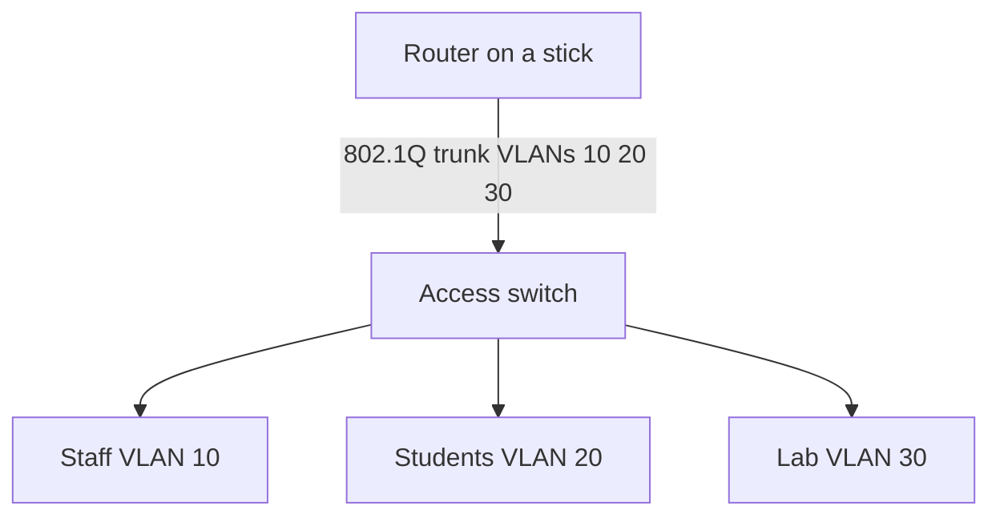

# Illustrative campus lab

This new example makes the included switch template understandable. It is not the original assessed topology and has not been tested in Packet Tracer.

| VLAN | Example subnet | Gateway | Suggested host range |
| --- | --- | --- | --- |
| 10 staff | 192.168.10.0/24 | 192.168.10.1 | .10 to .200 |
| 20 students | 192.168.20.0/24 | 192.168.20.1 | .10 to .200 |
| 30 lab | 192.168.30.0/24 | 192.168.30.1 | .10 to .200 |

The committed switch template places access ports in VLAN 20 and allows all three VLANs on the trunk. It does not implement router subinterfaces, inter-VLAN access controls or bandwidth policy. A working lab must add these and verify same-VLAN reachability, permitted inter-VLAN reachability, denied paths, port-security violations and management access. Record actual commands and packet-test outcomes before claiming a validated network.
